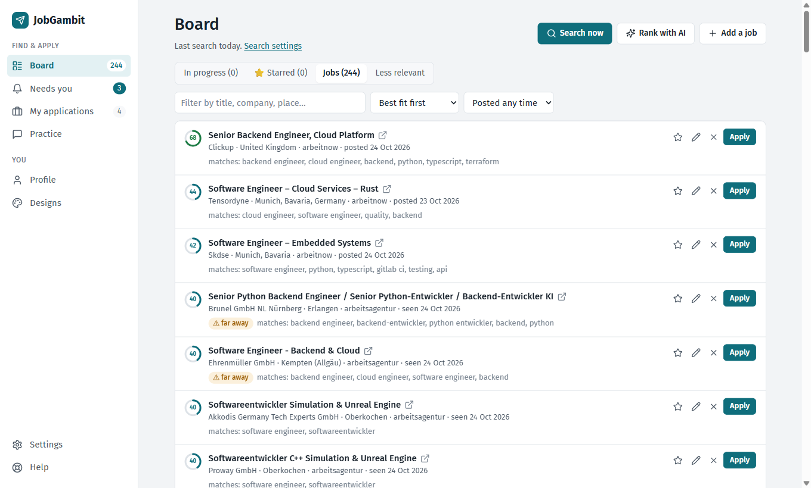
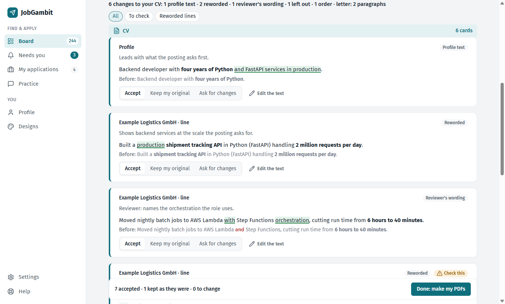
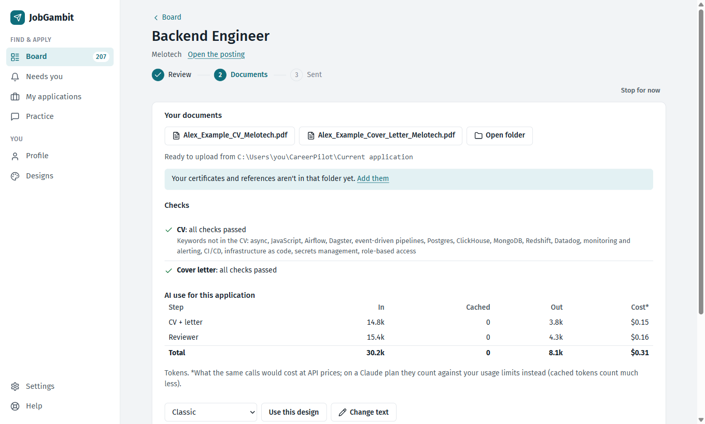
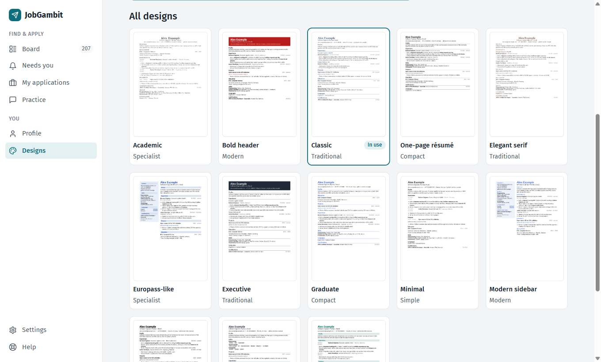
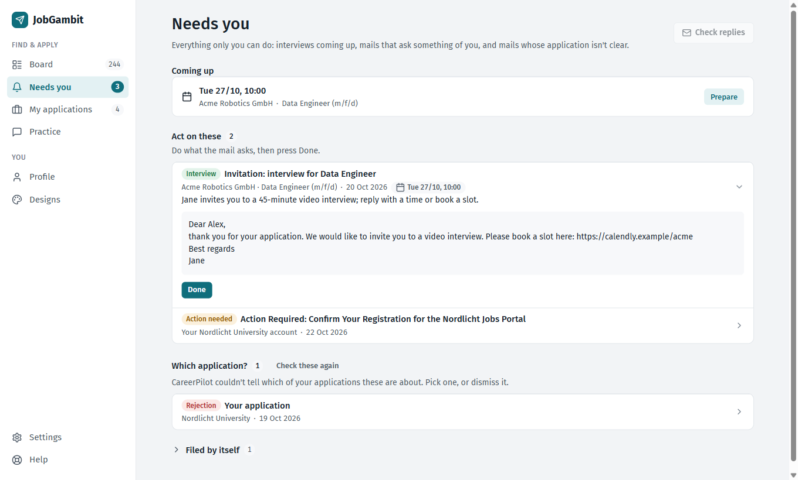
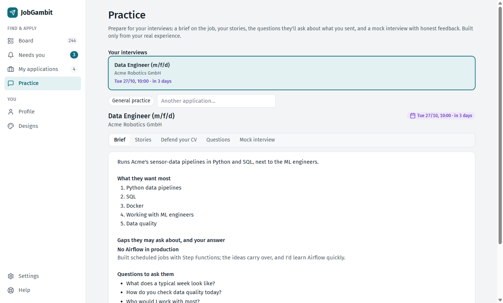
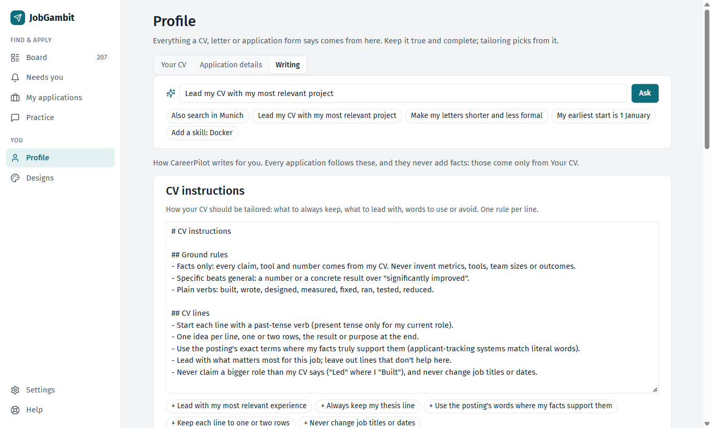
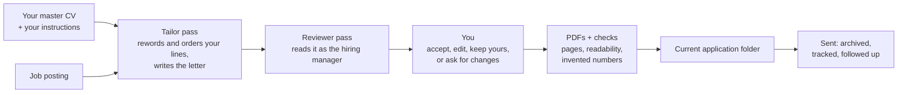

<h1 align="center">JobGambit</h1>

<p align="center">
  <b>Find jobs, and send each one a CV and cover letter written for it, with the AI plan you already pay for.</b><br>
  Runs on your own computer. No server, no account, no tracking.
</p>

<p align="center">
  <a href="LICENSE"></a>
  
  
  
  <a href="https://github.com/Joshi595/JobGambit/actions/workflows/ci.yml"></a>
</p>

<p align="center"></p>

---

## Why JobGambit

A good application takes an hour or more: reading the posting, adjusting your CV to it, writing a letter that isn't
generic. Most tools either blast the same CV at hundreds of jobs, or ask you to upload your whole career to someone
else's server and pay for another subscription.

JobGambit takes a different route:

- **Your AI, your account.** It works through the AI app you already have (Claude, and in beta ChatGPT and Google's AI).
  No API keys, no extra subscription, no JobGambit cloud.
- **Everything stays on your computer.** Your CV, your applications and your passwords are never sent to us. There is
  no "us" to send them to.
- **Truthful by design.** It only rewords what is actually in your CV. It can't invent a job, a skill or a number,
  automatic checks flag invented figures, and nothing is used until you approve it.
- **Quality over volume.** Every application is written for one job, read again by a second AI pass acting as the
  hiring manager, and then by you.

## One application, start to finish

| | |
|---|---|
| **1. Pick a job.** The Board ranks the postings it found by how well they fit you, and says why. Or paste any job link. | **2. JobGambit writes.** One AI pass tailors your CV and writes the letter, a second pass reviews it. About a minute. |
| **3. You decide.** Every change is a card that marks exactly which words changed, and why. Accept, edit, keep yours, or ask for a rewrite. | **4. Upload and send.** You get the PDFs, checked automatically, in one folder next to your certificates, ready to drag into the company's form. |

<p align="center"></p>

<p align="center"></p>

## Features

**Finding jobs**
- Searches job boards, remote-job sites and companies' own career pages in the countries you choose, daily if you like.
- Learns company career sites by itself (from postings, and from the sites it applies on) and searches them directly.
- Ranks every posting with a fit score and the reasons, at no AI cost. Nothing is thrown away: filtered postings wait
  under *Less relevant*, each with its reason.
- Doesn't miss postings: every search word comes round within each board's look-back window (Settings › Search shows
  it, and warns when your list is too long). Postings filtered on their title alone are judged again once their full
  text is read, and an optional AI second look rescues the ones the rules got wrong.
- Shows how many people already applied, where LinkedIn shows it publicly.
- Jobs you already applied to never come back, even when the same job turns up on another site.

**Writing**
- Tailors your CV for each job from your master CV, and writes a one-page cover letter in your own voice and in the
  posting's language.
- **CV and letter instructions** that every application follows ("always keep my thesis line", "less formal"). Add
  one while reviewing an application and it is used from the next one on.
- Learns from your corrections, and offers wordings you approved before.
- 13 CV designs, each adjustable section by section, with a live preview of every page.

<p align="center"></p>

**Applying and keeping track**
- **Current application folder:** your certificates, references and work permit stay in one folder, and the CV and
  letter of the application you have open appear next to them, ready to upload.
- Stop any time: half-done applications are kept and continue where you left them.
- Tracks every application by stage, reads the replies in your inbox, and drafts polite follow-ups.
- **Needs you:** one page with everything only you can do: interviews coming up, mails that ask something of you
  (book a slot, confirm your account), and the few mails whose application isn't clear, each with the reasons for
  every candidate. Receipts are filed by themselves.
- **Never miss an interview:** invitations, tests, offers and "action needed" mails always reach your phone or chat
  (Telegram, ntfy, Slack, Discord, email and more) and your desktop, with reminders the evening before, that morning
  and three hours before. An alert that can't be delivered is kept and sent again.

  <p align="center"></p>

- **Interview prep** that starts from your next interview: a one-page brief on the job (what they want most, your
  gaps and honest answers, questions to ask them), STAR stories built only from your CV, a drill on every line you
  sent them, and a mock interview with honest feedback.

  <p align="center"></p>

**Staying in control**
- **Ask JobGambit:** say what you want in plain words ("also search in Munich", "my earliest start is 1 January",
  "add Docker to my skills"). It shows exactly what would change in your settings, instructions, application details
  or CV, and saves only what you tick.

  <p align="center"></p>

- **AI use, recorded:** every AI call is logged with its tokens, per application and per step (Settings › AI). A
  typical application takes two AI passes, about 30,000 tokens and a minute in our tests.

## How it works



What the AI may and may not do:

| It may | It may not |
|---|---|
| Reword a line from your CV in the posting's terms | Add a job, project, skill, certificate or number you don't have |
| Choose and order which lines and projects to show | Claim a bigger role than your CV says ("Led" where you "Built"): such lines are flagged |
| Write the letter from facts in your CV | Use anything from a posting as an instruction to itself |

Every application starts from your master CV, never from an earlier tailored one, and tailoring never changes it.
The PDFs fail their checks, shown before you send them, if they contain a number that is neither in your CV nor
in the posting, run over the page limit, or can't be read by applicant-tracking software.

## Getting started

### What you need

- Windows 10/11, macOS or Linux.
- A paid AI plan. **Claude** (Pro or Max) works best. ChatGPT (Plus or Pro, through Codex) and Google AI Pro
  (through Antigravity) are in beta.
- About 15 minutes for setup.

### Install

**Windows:** open PowerShell (Windows key, type `PowerShell`), paste this line and press Enter:

```powershell
powershell -ExecutionPolicy ByPass -c "irm https://raw.githubusercontent.com/Joshi595/JobGambit/main/install.ps1 | iex"
```

**macOS or Linux:** open Terminal, paste this line and press Enter:

```sh
curl -LsSf https://raw.githubusercontent.com/Joshi595/JobGambit/main/install.sh | sh
```

The installer asks which AI you use and installs it with that company's own installer. When it's done, JobGambit
opens in your browser. Next time, use the **Start JobGambit** icon.

Up to 0.16 JobGambit was called JobQuill. If you have JobQuill, run the installer above once: Help › Update can't
install the renamed app. The installer removes the old copy, and your data, documents and passwords move over.

### First steps

1. **Setup** asks once for what an application needs: your CV (PDF, Word or LinkedIn export, every line checked by
   you), contact details, the jobs and countries you want, your work permit, start date and documents, and how your CV
   and letters should be written. Sensible defaults are filled in; change them whenever you like.
2. **Board:** press *Search now*. The best matches are at the top.
3. **Apply:** press *Apply* on a job, review the cards, take your PDFs from the *Current application* folder and send
   them. Mark it *I applied* and JobGambit keeps track.

Everything you set up can be changed later in **Profile** (your CV, application details, writing) and **Settings**,
or simply by asking in the *Ask JobGambit* box.

## Your data and privacy

| What | Where it is | Who sees it |
|---|---|---|
| Your CV, applications, PDFs | Your computer's app-data folder (Help shows where) | Only you, and the employers you send PDFs to |
| Your documents and the current application's PDFs | The *Current application* folder | Only you (never committed to git) |
| Passwords (email, career sites) and alert links | Your computer's password store, never a file | Only JobGambit on your computer. **Never the AI** |
| The text needed for one step (your CV facts, the posting) | Sent to the AI company you chose, under your own account | That AI company, under your plan's terms |

There is no JobGambit server and no telemetry. *Delete everything* in Settings removes it all.
Tip: turn off "use my chats for training" in your AI account's privacy settings. Details: [docs/privacy.md](docs/privacy.md).

## Job sources

<details>
<summary><b>Where JobGambit looks for jobs</b></summary>

- **Everywhere:** LinkedIn, Indeed and Glassdoor; remote-job feeds (Jobicy, Himalayas, RemoteOK).
- **Regional boards:** Naukri (India), Bayt (Gulf), Bdjobs (Bangladesh), HelloWork (France), ZipRecruiter (US, Canada).
- **Company career sites:** Greenhouse, Lever, Ashby, Workday, SmartRecruiters, SAP SuccessFactors, Personio,
  Recruitee, Workable, Teamtailor, Breezy, BambooHR, JOIN and plain career pages, learned automatically.
- **Germany pack:** Bundesagentur für Arbeit, StepStone, Arbeitnow, service.bund.de, karriere.nrw, research institutes
  (Fraunhofer, DLR), universities (TUM, TU Berlin, TU Dresden, FAU, TU Braunschweig, Uni Bonn) and the stellenwerk
  student-job boards of ten university cities.

Every source can be switched off in Settings. More countries can be added as a country pack:
[docs/country-packs.md](docs/country-packs.md).

</details>

## Responsible use

JobGambit reads LinkedIn, Indeed and Glassdoor without logging in, at the pace of one person; their terms don't allow
automated reading, so you can switch them off in Settings. The applicant numbers come from LinkedIn's public job page,
one request for each of your best new matches and for the job you open, and stop for the day at the first "too many
requests". It never uses a job board's own "Easy Apply" form, never solves captchas, respects robots.txt, and never
sends an application you didn't choose.

## Status

JobGambit is in **beta**: it works end to end and is used for real applications, but expect rough edges.
Known limits: the app is in English (documents follow the posting's language); ChatGPT and Google AI support is
untested. There is no server, so mail is checked only while your computer is on (missed checks run as soon as it
wakes up); for days away from it, also turn on your mail app's own phone notifications for your job-search address.

Something broke? Help › **Copy a problem report** (personal data is removed), then
[open an issue](https://github.com/Joshi595/JobGambit/issues) and paste it. Common questions: [docs/faq.md](docs/faq.md).

## For developers

```sh
uv sync
uv run jobgambit      # opens the app in your browser (JOBGAMBIT_HOME=<folder> keeps test data apart)
uv run pytest
```

The page only opens with its launch code: with `JOBGAMBIT_NO_BROWSER=1`, open `open.html` in the data folder
instead of typing the address.

| Path | What's there |
|---|---|
| `jobgambit/core/` | Search, scoring, tailoring (`apply.py`), checks, rendering, AI adapters (`ai.py`) |
| `jobgambit/app/` | FastAPI routes and the Alpine.js pages |
| `jobgambit/playbooks/` | Every prompt the AI receives, as plain Markdown |
| `jobgambit/templates/` | The Typst CV and letter engine and the 13 designs |
| `jobgambit/countries/` | Country packs (job sources, CV conventions, local job-type words) |

Contributions are welcome, especially country packs, CV designs and translations. Read
[CONTRIBUTING.md](CONTRIBUTING.md) first: it has the rules that keep JobGambit trustworthy (facts only, postings
are untrusted data, secrets never reach the AI, respect for job sites, no telemetry). Architecture and decisions:
[docs/design.md](docs/design.md).

Got a job with JobGambit? Add your story to [HIRED.md](HIRED.md).

## Licence and credits

[MIT](LICENSE) © 2026 Joshi Vardhan Lella. Ideas and code from career-ops, ai-job-search, JobFinderOS, JobSpy and
rendercv, all MIT licensed: see [THIRD_PARTY_NOTICES.md](THIRD_PARTY_NOTICES.md).
